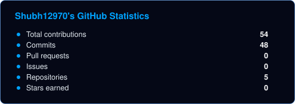
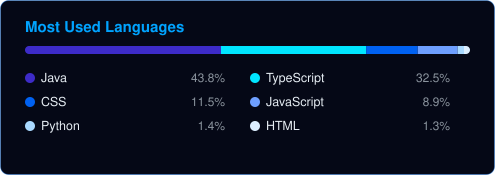
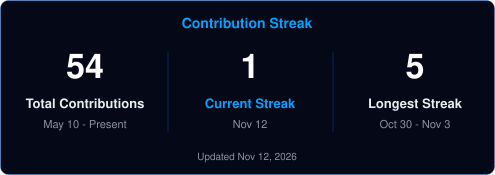
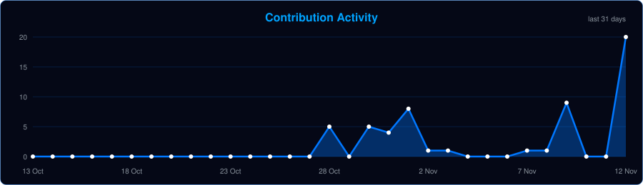

 

 

  

*Building useful software. Exploring AI. Learning by creating.*

---

## 01 / About Me

Hello! I'm **Shubhra Jyothsna**, a second-year B.Tech student in Electronics and Communication Engineering (ECE) at the **Indian Institute of Information Technology, Senapati, Manipur**.

I'm interested in **full-stack development and artificial intelligence**, with a focus on developing applications that combine intuitive user interfaces, backend functionality, and intelligent features.

I enjoy learning new technologies, solving problems, and turning ideas into practical software projects.

- Exploring full-stack web development and AI-powered applications.
- Building projects that address real-world problems.
- Developing my programming and computer science fundamentals.
- Continuously learning through hands-on projects.

---

## 02 / Featured Projects

<table>
<tr>
<td width="50%" valign="top">

<h3>AI Student Productivity Dashboard</h3>

An **AI-powered student productivity dashboard** built to support student productivity through a modern web application.

**Technology stack**

- React
- TypeScript
- Node.js

**Project status:** In development

</td>
<td width="50%" valign="top">

<h3>CivicLens AI</h3>

An **AI-powered civic engagement platform** that helps citizens report local issues, support community priorities, and track progress toward safer, cleaner, and better cities.

**Project focus**

- Civic issue reporting
- Community participation
- Local issue prioritization
- Progress tracking

**Project status:** In development

</td>
</tr>
</table>

---

## 03 / Technical Skills

### Programming Languages

### Frontend Development

### Backend Development

### Core Computer Science

- Data Structures and Algorithms (DSA)
- Object-Oriented Programming (OOP)

### Databases

### Tools & Platforms

---

## 04 / GitHub Analytics

 

---

## 05 / Contribution Activity

---

## 06 / Let's Connect

I'm interested in learning, collaborating, and building meaningful software projects.

  

*Learn continuously. Build thoughtfully. Improve consistently.*

 

B.Tech ECE · IIIT Senapati, Manipur · Full-Stack Development & AI

  

